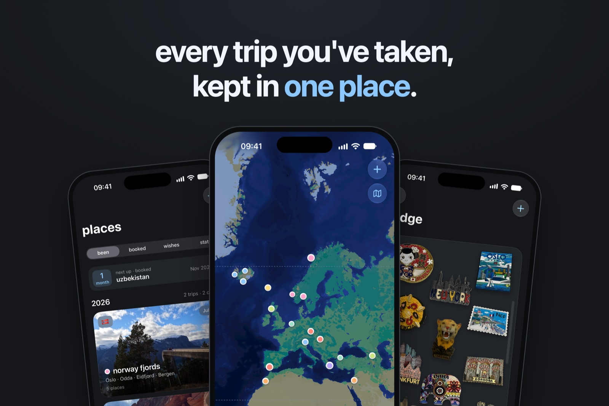
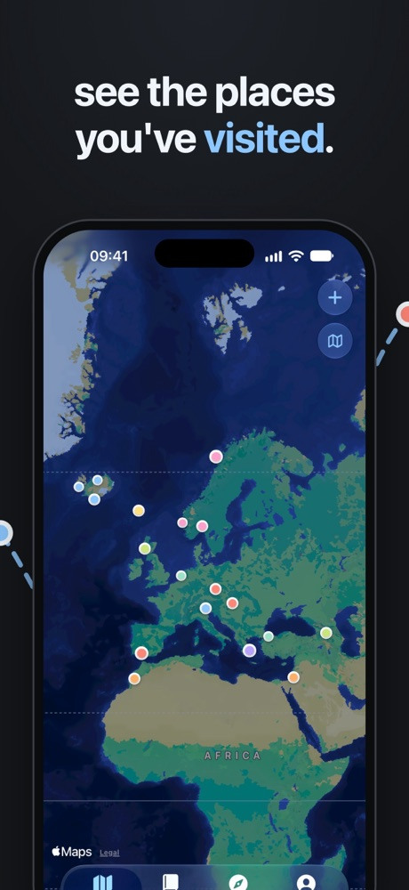
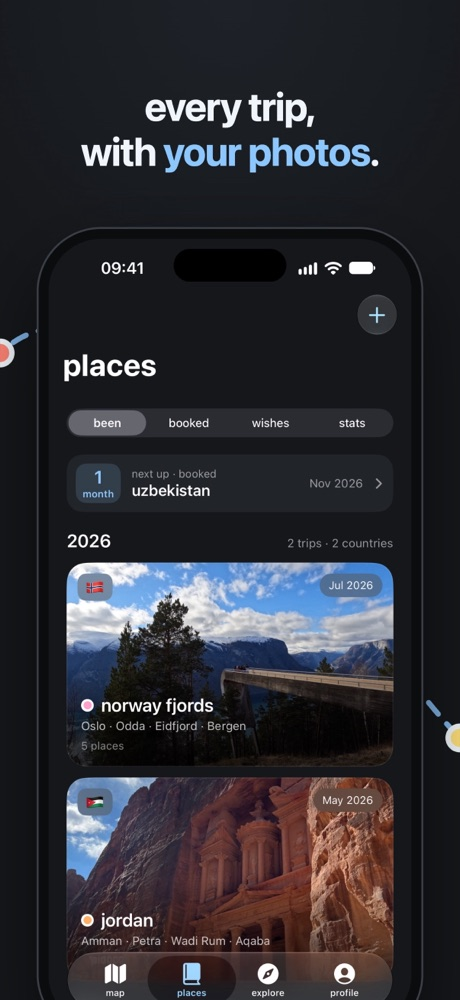
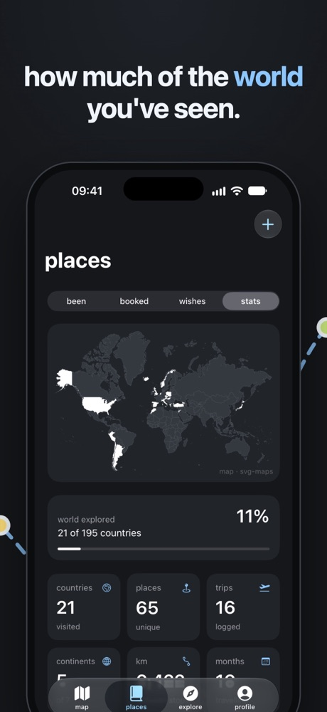
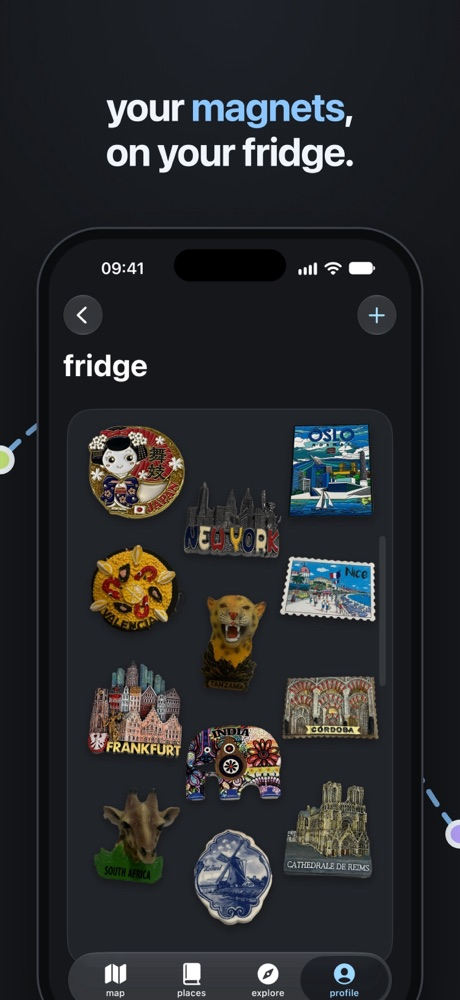
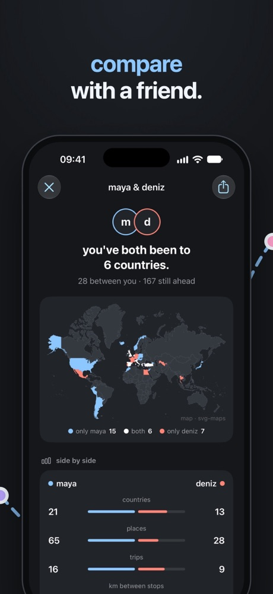
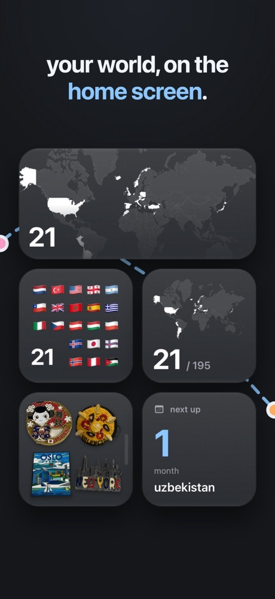
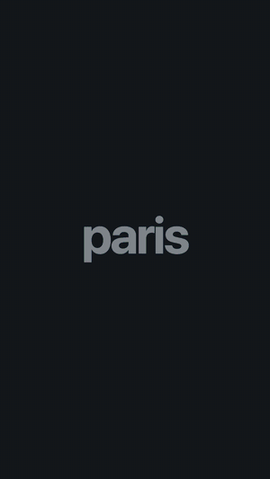

# dotlas

Gezdiğin ülkeleri ve şehirleri kaydeden, hepsini bir dünya haritasında gösteren iOS uygulaması. Tasarımını ve kodunu tek başıma yaptım; 29 Ekim 2026'dan beri App Store'da.

**[App Store'da dotlas](https://apps.apple.com/app/dotlas/id6816267686)** · ücretsiz · iPhone, iOS 18 ve üstü

## Ekranlar

| | | |
| :---: | :---: | :---: |
|  |  |  |
|  |  |  |

## Özellikler

### Harita
Her gezinin yerleri haritada o gezinin renginde nokta olarak görünür. Bir noktaya dokununca gezinin kartı açılır, karttan gezi sayfasına geçilir. Yeni bir gezi eklendiğinde harita o geziye uçar ve yerleri gezinin renginde bir halkayla belirir; birkaç gezi birden eklenirse sırayla gelirler. Yaşanan şehirler de haritada durur.

### Geziler
Bir gezi, yer arayıp tarih seçerek eklenir. Geziler yıllara göre listelenir. Üç türü var: gidilmiş geziler, kalan süresi gösterilen planlanmış geziler ve gidilmek istenen yerler için dilekler. Her gezi, kullanıcının yaşadığı şehirlerden hangisinden yola çıktığını bilir; evden ilk durağa ve son duraktan eve olan yol da gezinin mesafesine eklenir.

### Gezi sayfası
Yerler, rota, tarihler, notlar, o gezide çekilen fotoğraflar ve o geziden getirilen magnetler bir arada. Karayolu gezilerinde rota gerçek yollar üzerinden çizilir.

### Gezi fotoğrafları
Fotoğraf kütüphanesindeki fotoğraflar gezinin tarihine ve konumuna göre bulunur ve cihazda değerlendirilir: manzaralar, yapılar ve iyi çekilmiş kareler öne, bulanık, karanlık, araç içi ve belge fotoğrafları arkaya alınır; favoriler her zaman öndedir. Kullanıcı seçimi istediği gibi değiştirebilir. Hiç fotoğrafı olmayan gezilerde yakındaki ünlü bir yapının fotoğrafı Wikipedia'dan, fotoğrafçısı ve lisansıyla gösterilir.

### Magnet buzdolabı
Gezilerden getirilen buzdolabı magnetinin fotoğrafı çekilir. dotlas magneti fotoğraftan keser, tutan eli çıkarır ve uygulamadaki buzdolabına yapıştırır. Magnetin üstündeki yazıyı okuyup hangi yerden olduğunu önerir; magnet o yere bağlanır ve o yerin gezisinin sayfasında da görünür.

### İstatistikler ve rozetler
Kaç ülke, kıta, yer ve kilometre gezildiği, dünyanın ne kadarının görüldüğü, en kuzeydeki ve en güneydeki yer ve evden en uzak nokta. Sayılar arttıkça 45 rozet açılır: "ten countries", "the balkans", "equator crossing", "arctic circle" gibi. Toplanan puanlara göre beş gezgin unvanı var: traveller, explorer, voyager, globetrotter ve cartographer.

### Keşfet
27 hazır gezi fikri, rotalarıyla birlikte. Beğenilen fikir tek dokunuşla dilek olarak eklenir.

### Paylaşım
- **Yıl kartı:** o yılın gezileri tek bir resimde.
- **Rota posteri:** bir gezinin adı, tarihleri ve Apple haritası üzerinde gezinin renginde çizilmiş rotası.
- **Rota videosu:** posterin hareketli hali; harita ilk yere yaklaşır, rota çizilirken her yer adıyla belirir. Dikey, 1080×1920.

### Arkadaşla karşılaştırma
İki kişi birbirinin kodunu kamerayla tarar ve gezdikleri ülkeleri karşılaştırır: ortak ülkeler, birinin gidip diğerinin gitmediği yerler. Kod yalnızca isim, sayılar ve ülke kodlarını taşır; internete hiçbir şey gönderilmez.

### Widget'lar, Spotlight ve Siri
Dört widget var: dünyanın ne kadarının görüldüğü harita, ülke bayrakları, sıradaki gezi ve magnet buzdolabı. Geziler iPhone aramasında (Spotlight) çıkar, Siri'ye "open lisbon weekend in dotlas" denince o gezi açılır.

### Görünüm, yedek ve gizlilik
Gece, gündüz ya da telefonun ayarına uyan görünüm. iOS 26'da Liquid Glass. Tüm atlas tek bir dosya olarak dışa aktarılabilir ve yeni bir iPhone'a geri yüklenebilir. Hesap yok, sunucu yok, reklam yok; veriler telefonda kalır ve iPhone yedeğine dahildir.

## Teknik

Swift ve SwiftUI ile, üçüncü parti kütüphane kullanmadan, Apple framework'leri üzerine kurulu.

| Konu | Nasıl |
| --- | --- |
| Veri | Tüm atlas tek bir JSON dosyası; her değişiklik anında kaydedilir. Dosya okunamazsa bir kopyası saklanır ve kullanıcı karar verene kadar üzerine yazılmaz. |
| Harita ve rota | MapKit. Duraklar arasındaki yol `MKDirections` ile gerçek karayolundan çizilir; yol bulunamayan bacaklar düz çizgi olarak kalır. |
| Dünya haritası | Places sekmesindeki harita, [svg-maps](https://github.com/VictorCazanave/svg-maps) verisinden bir Node betiğiyle üretilen küçük bir JSON'dan uygulamada çizilir. |
| Gezi fotoğrafları | PhotoKit ile tarih ve konuma göre eşleştirme; Vision'ın görüntü sınıflandırma ve estetik puanlarıyla sıralama. Hepsi cihazda. |
| Magnet kesme | Vision'ın ön plan maskesiyle magnet fotoğraftan ayrılır, tutan el insan maskesiyle çıkarılır; Vision'ın metin tanıması magnetteki yer adlarını okur. |
| Rota videosu | Her kare çizilip AVFoundation (`AVAssetWriter`) ile videoya yazılır. |
| Karşılaştırma | Ülkeler bir koda yazılır; VisionKit'in `DataScannerViewController`'ı ile okunur. |
| İstatistikler | Swift Charts. |
| Widget'lar | WidgetKit; uygulama, widget'ların göstereceği her şeyi App Group klasörüne hazırlar. |
| Spotlight ve Siri | Core Spotlight ile her gezi aranabilir; App Intents ile Siri kısayolları. |

## Sayılarla

- Yaklaşık 18.400 satır Swift, 57 dosya
- İlk commit 23 Eylül 2026; App Store'da 29 Ekim 2026 (1.0) ve 1 Kasım 2026 (1.1)

## Kaynak kodu

Kaynak kodu private bir repoda. Görmek isteyenlere erişim verebilirim: [dotlasapp@gmail.com](mailto:dotlasapp@gmail.com)
